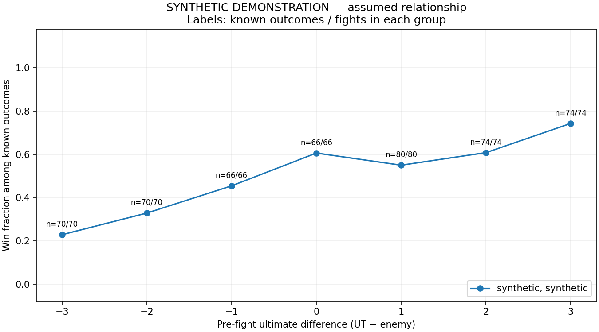

# Overwatch Teamfight Analytics

A reproducible exploratory analytics project investigating factors **associated with winning teamfights** in competitive Overwatch. Phase 1 uses Python, Pandas, SQLite, and Matplotlib. The focus is data quality, SQL analysis, and honest interpretation.

## Research objectives

| Hypothesis | Phase 1 treatment |
| --- | --- |
| H1: Ultimate economy is associated with teamfight outcomes. | Quantitative exploration of pre-fight readiness difference, with sample sizes and missingness. |
| H2: Positioning affects teamfight outcomes. | Qualitative notes only; reliable positioning measurements are unavailable. |
| H3: Team coordination affects teamfight outcomes. | Qualitative notes only; reliable coordination measurements are unavailable. |

The repository currently contains **two real annotated fights from one match**, both with `ult_diff=0`. One has a recorded win and one a loss. This is a description of these two annotations, not an estimate of competitive Overwatch win rates. There is no variation in observed ultimate difference, so these observations cannot evaluate H1. No significance test, causal claim, or predictive model is presented.

## Data sources and limitations

- `data/raw/teamfights_raw.csv`: original **16-column** replay annotation file, preserved byte for byte, including all notes, hero labels, timestamps, and confidence values. No attempt is made to correct or reinterpret its composition labels.
- `data/real/teamfights.csv`: original **10-column** converted annotations, also preserved. It repeats the same two fight identities, marks them `replay`, and records medium confidence. Replay status is inherited from these annotations; this implementation did not independently verify replay footage.
- `data/real/teamfights_memory.csv`: header-only intake file for actual player recollections. No memory observations have been invented. Add only real recollections, with uncertainty explained in `notes` and an appropriate recorded confidence when available.
- Synthetic rows are generated separately and visibly labeled `synthetic`. Their association is imposed by an assumed formula, not learned from real matches. See [simulation assumptions](docs/simulation.md).

The pipeline converts raw counts and timestamps, then reconciles repeated raw/legacy fight identities without double-counting. Conflicting known facts fail validation; compatible observations fill missing cells from recorded information only. Both notes are retained and the lower recorded confidence is used. Other raw fields remain available in the untouched source. Newly converted raw data defaults to `replay`, following this repository's existing labels; use `--raw-source memory` for a memory-only raw file and supply compatible legacy inputs.

Missing measurements stay missing. `Unknown` first picks normalize to an empty cell in derived data. No first pick is inferred from narrative notes. Both readiness counts are needed for `ult_diff`; both times are needed for duration. Existing metadata confidence differences are documented in the [annotation protocol and data dictionary](docs/annotation_protocol.md).

## Repository structure

```text
data/raw/                       Original 16-column annotations (immutable)
data/real/                      Original analysis CSV and empty memory intake
src/validate_data.py             Shared validation and standalone validator
src/data_pipeline.py             Raw conversion, reconciliation, seeded simulation
src/run_analysis.py              Pandas, SQLite, charts, reports, manifest
sql/                            Source/confidence-stratified SQL summaries
tests/                          Validation, missingness, separation, reproducibility
docs/annotation_protocol.md     Data dictionary, timing, source rules
docs/simulation.md              Explicit simulation assumptions
docs/examples/                  Generated example reports and charts
output/real/                    Generated real-only CSV, SQLite, SQL tables, plots, report
output/synthetic/               Generated synthetic-only equivalents
output/manifest.json            Seed, input hashes, runtime versions
```

The existing `data/processed/`, `data/synthetic/`, and `notebooks/` placeholders remain for compatibility. Generated datasets live inside their output population folders so a complete run is portable; no additional copy of the inputs is maintained.

## Installation and execution

Use **Python 3.12**. SQLite is part of Python's standard library. Dependencies, including transitive versions, are pinned in `requirements.txt`.

```bash
git clone https://github.com/AngeloWang0427/overwatch-teamfight-analytics.git
cd overwatch-teamfight-analytics
python3.12 -m venv .venv
source .venv/bin/activate
python -m pip install -r requirements.txt
python src/validate_data.py
python src/validate_data.py data/real/teamfights.csv --schema analysis
python -m pytest -q
python src/run_analysis.py
```

On Windows, activate with `.venv\Scripts\Activate.ps1` in PowerShell. Commands run from the repository root; the scripts resolve default inputs relative to the repository, so they also work from other directories.

Open `output/report.md` for links to each population's report. Each output folder contains:

- `analysis.csv`: exact 10-column analysis schema; unknown cells are empty.
- `teamfights.sqlite`: a `fights` table and unique `(match_id, fight_id)` index.
- `by_source.csv`, `by_ult_diff.csv`, `by_first_pick.csv`, `missingness.csv`: exported SQL results.
- `ult_outcomes.png`, `completeness.png`: annotated Matplotlib charts.
- `report.md`: generated tables, denominators, limitations, and embedded chart links.

Optional reproducible run:

```bash
python src/run_analysis.py --seed 42 --synthetic-rows 500 --output output/demo
```

Custom inputs use `--raw PATH --real PATH --memory PATH`, with header-only CSVs allowed when a source has no observations. The output directory must be separate from inputs. A run replaces its generated files; source files are never written. Real inputs are validated before output generation begins. Failure messages identify the column and CSV row where applicable.

## Example outputs and interpretation

Browse the committed [real report](docs/examples/real/report.md) and [synthetic demonstration](docs/examples/synthetic/report.md), generated with seed 42 and 500 simulated fights. These are snapshots; rerun the pipeline for current inputs. Runtime manifests are generated locally rather than claiming cross-platform byte-identical SQLite or PNG files.



Every summary retains `data_source` and `confidence`; replay and memory results are never pooled into one rate. Real and synthetic observations use separate files and databases. `n_fights` counts all fights in a group; `n_outcomes` counts known outcomes and is the denominator of `win_rate` (a fraction from 0 to 1). Duration means use `n_durations`. Zero eligible observations produce a missing rate rather than zero. Missing advantages are omitted only from ultimate groupings and remain in source and completeness summaries. Unknown first picks are excluded from first-pick groupings and counted as missing in completeness summaries.

Readiness is intended as a **pre-fight** variable. First pick occurs **during** combat; duration and outcome are observed **after** combat. Treating the latter as pre-fight predictors would leak information. Current annotation timing needs a consistent replay audit before stronger H1 interpretation. Selection bias, match dependence, map, hero composition, rank, and patch can confound associations. The synthetic generator does not model those complexities.

## Tests and reproducibility

Tests cover invalid and nonfinite numbers, fractional counts, duplicate identities, missing observations, SQL null denominators, conflicting annotations, preservation of original files, replay/memory separation, synthetic isolation, empty inputs, and identical full-pipeline artifacts for a fixed seed and installed runtime. GitHub Actions runs validation, tests, and analysis and uploads the generated outputs. Input hashes, runtime versions, and seed appear in the run manifest.

## Future improvements

1. Collect more replay-verified matches across maps, patches, and ranks using a consistent engagement boundary and pre-fight snapshot.
2. Audit the current two annotations, including readiness timing and composition labels; record corrections as reviewed new annotations without silently overwriting the raw source.
3. Track annotation disagreements and inter-rater agreement, with a documented revision trail.
4. Define reliable spatial and coordination measurements before quantitatively evaluating H2 or H3.
5. With enough independent matches, consider uncertainty estimates accounting for match clustering and confounders. Any predictive modeling would require a separate justified scope, sufficient verified data, and match-level validation.
