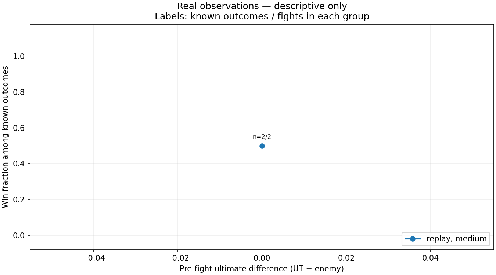
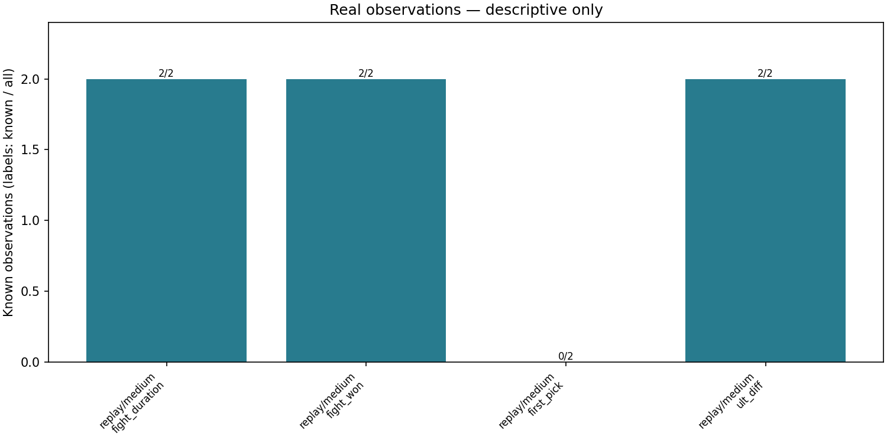

# Real observations — descriptive only

Records: **2**. Matches: **1**.

Replay and memory observations remain separate below. Replay is the existing annotation label; this pipeline did not independently watch replays. The current real sample is insufficient for significance, causal, population win-rate, or reliable predictive claims.

replay: N=2 fights; ultimate difference recorded for N=2, with 1 distinct recorded values.
H1 cannot be evaluated in this source: no variation in recorded ultimate difference.

memory: N=0 fights; ultimate difference recorded for N=0, with 0 distinct recorded values.
H1 cannot be evaluated in this source: no variation in recorded ultimate difference.

## by first pick

| data_source | confidence | first_pick | n_fights | n_matches | n_outcomes | wins | win_rate |
| --- | --- | --- | --- | --- | --- | --- | --- |

No eligible observations.

## by source

| data_source | confidence | n_fights | n_matches | n_outcomes | wins | win_rate | n_durations | mean_duration_sec |
| --- | --- | --- | --- | --- | --- | --- | --- | --- |
| replay | medium | 2 | 1 | 2 | 1 | 0.500 | 2 | 24.500 |

## by ult diff

| data_source | confidence | ult_diff | n_fights | n_matches | n_outcomes | wins | win_rate |
| --- | --- | --- | --- | --- | --- | --- | --- |
| replay | medium | 0 | 2 | 1 | 2 | 1 | 0.500 |

## missingness

| data_source | confidence | variable | n_fights | n_known | n_missing |
| --- | --- | --- | --- | --- | --- |
| replay | medium | fight_duration | 2 | 2 | 0 |
| replay | medium | fight_won | 2 | 2 | 0 |
| replay | medium | first_pick | 2 | 0 | 2 |
| replay | medium | ult_diff | 2 | 2 | 0 |

## Coverage and interpretation

- memory: N=0 annotated fights.
- replay: N=2 annotated fights.

- Rates use only known outcomes; n_outcomes is their denominator. Missing outcomes never become losses.
- Ultimate differences require both recorded readiness counts. Unknown advantages are excluded only from the ultimate grouping.
- H1 concerns readiness immediately before engagement. Existing timestamps need replay audit to establish that timing consistently.
- First pick occurs during combat. Duration and outcome are measured after the fight. These are descriptive variables, not pre-fight predictors.
- H2 (positioning) and H3 (coordination) remain qualitative: notes are retained, with no invented quantitative scores.
- Fights within matches are correlated; maps, compositions, rank, patch, and selection may confound any observed association.
- No imputation, significance test, causal estimate, or predictive model is used.

