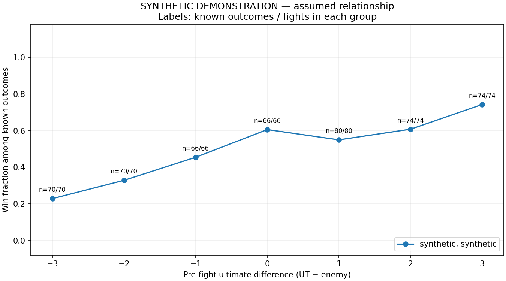
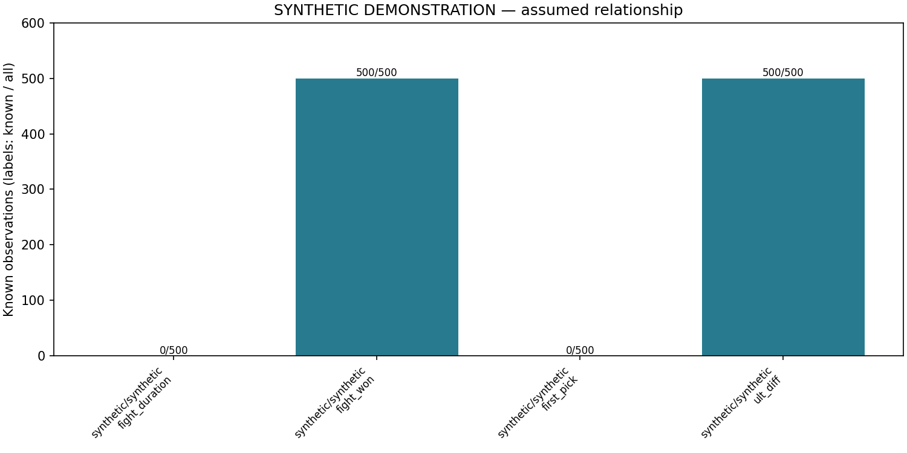

# SYNTHETIC DEMONSTRATION — assumed relationship

Records: **500**. Matches: **50**.

These are simulated outcomes, not empirical Overwatch win rates. The generator imposes an association; these results cannot validate H1.

## by first pick

| data_source | confidence | first_pick | n_fights | n_matches | n_outcomes | wins | win_rate |
| --- | --- | --- | --- | --- | --- | --- | --- |

No eligible observations.

## by source

| data_source | confidence | n_fights | n_matches | n_outcomes | wins | win_rate | n_durations | mean_duration_sec |
| --- | --- | --- | --- | --- | --- | --- | --- | --- |
| synthetic | synthetic | 500 | 50 | 500 | 253 | 0.506 | 0 | — |

## by ult diff

| data_source | confidence | ult_diff | n_fights | n_matches | n_outcomes | wins | win_rate |
| --- | --- | --- | --- | --- | --- | --- | --- |
| synthetic | synthetic | -3 | 70 | 39 | 70 | 16 | 0.229 |
| synthetic | synthetic | -2 | 70 | 38 | 70 | 23 | 0.329 |
| synthetic | synthetic | -1 | 66 | 39 | 66 | 30 | 0.455 |
| synthetic | synthetic | 0 | 66 | 38 | 66 | 40 | 0.606 |
| synthetic | synthetic | 1 | 80 | 44 | 80 | 44 | 0.550 |
| synthetic | synthetic | 2 | 74 | 41 | 74 | 45 | 0.608 |
| synthetic | synthetic | 3 | 74 | 41 | 74 | 55 | 0.743 |

## missingness

| data_source | confidence | variable | n_fights | n_known | n_missing |
| --- | --- | --- | --- | --- | --- |
| synthetic | synthetic | fight_duration | 500 | 0 | 500 |
| synthetic | synthetic | fight_won | 500 | 500 | 0 |
| synthetic | synthetic | first_pick | 500 | 0 | 500 |
| synthetic | synthetic | ult_diff | 500 | 500 | 0 |

## Coverage and interpretation

- synthetic: N=500 annotated fights.

- Rates use only known outcomes; n_outcomes is their denominator. Missing outcomes never become losses.
- Ultimate differences require both recorded readiness counts. Unknown advantages are excluded only from the ultimate grouping.
- H1 concerns readiness immediately before engagement. Existing timestamps need replay audit to establish that timing consistently.
- First pick occurs during combat. Duration and outcome are measured after the fight. These are descriptive variables, not pre-fight predictors.
- H2 (positioning) and H3 (coordination) remain qualitative: notes are retained, with no invented quantitative scores.
- Fights within matches are correlated; maps, compositions, rank, patch, and selection may confound any observed association.
- No imputation, significance test, causal estimate, or predictive model is used.

